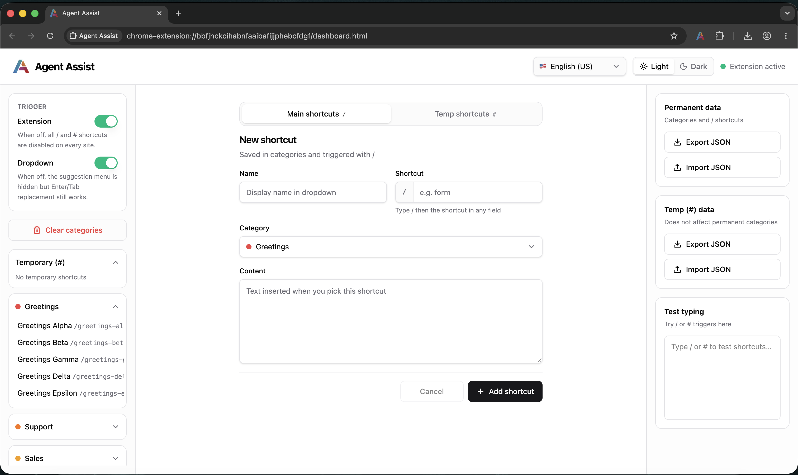
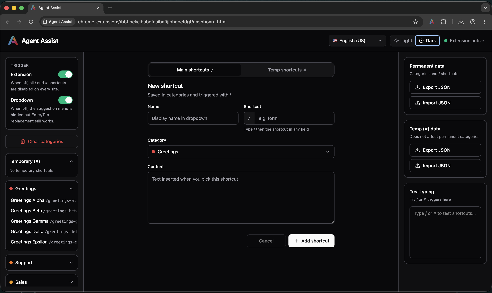
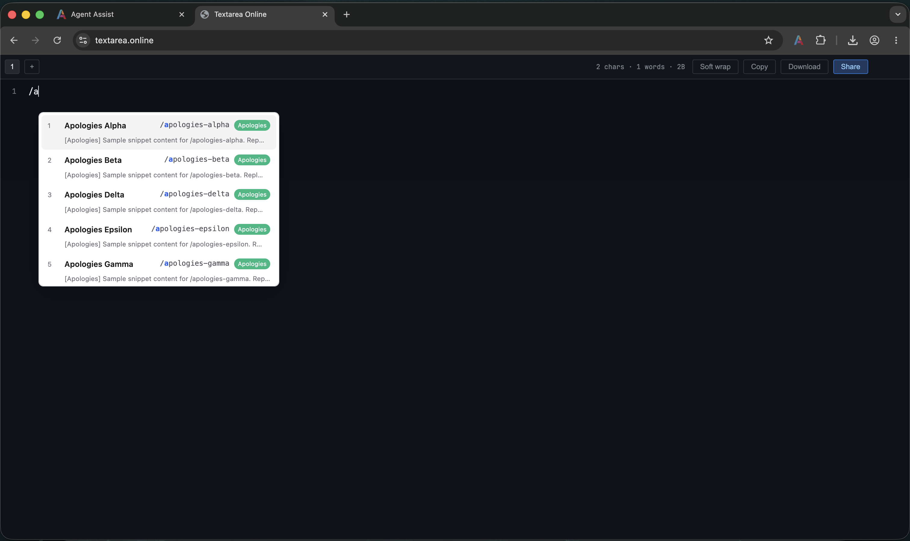
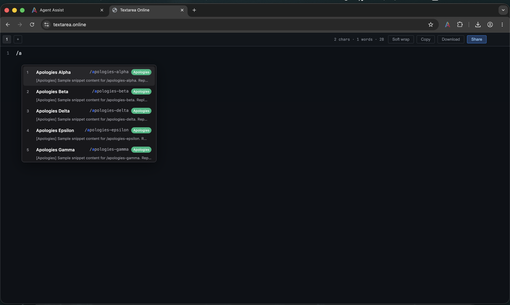

<p align="center">
  
</p>

<h1 align="center">Agent Assist — Homepage</h1>

<p align="center">
  <strong>Marketing site for Agent Assist — text shortcuts for support agents, anywhere you type.</strong><br />
  Built with Next.js, localized routes (<code>/en</code>, <code>/fa</code>, …), and live GitHub release downloads.
</p>

<p align="center">
  <a href="./LICENSE"></a>
  
  
  
</p>

<p align="center">
  <a href="https://github.com/mohammad-mghn/agent-assist">Extension repo</a>
  ·
  <a href="https://github.com/mohammad-mghn/agent-assist/releases/latest">Latest release</a>
</p>

<p>
  
</p>

<p>
  
</p>

<p>
  
</p>

<p>
  
</p>

---

## What it is

This is the **marketing homepage** for [Agent Assist](../extension/) — the browser extension that brings `/` and `#` text shortcuts into any textarea or rich-text field on the web.

The site introduces the product, links to GitHub releases, walks users through manual installation, and supports six locales with RTL where needed.

For extension features, usage, and development, see the [extension README](../extension/README.md).

---

## Features

### Localized routes

Six languages with locale-prefixed URLs:

| Path | Language |
|------|----------|
| `/en` | English (US) — default |
| `/en-gb` | English (UK) |
| `/fa` | Persian (فارسی) |
| `/ar` | Arabic (العربية) |
| `/tr` | Turkish (Türkçe) |
| `/ku` | Kurdish (کوردی) |

RTL layout is applied automatically for Persian, Arabic, and Kurdish.

### Live release downloads

The install section fetches the latest GitHub release via the Releases API. Version tag, publish date, and browser-specific zip links (Chrome / Firefox) stay up to date without hardcoding.

### Product sections

- **Hero** — value prop, browser-aware download CTA, GitHub link
- **Features** — bento grid highlighting key extension capabilities
- **How it works** — three-step onboarding
- **Installation** — Chrome and Firefox tabs with step-by-step load-unpacked instructions
- **Team** — contributors and contribution call-to-action

### Theme support

Light and dark mode via `next-themes`, matching the extension dashboard aesthetic.

---

## Stack

| Layer | Choice |
|-------|--------|
| Framework | Next.js 15 App Router |
| i18n | next-intl with middleware + `[locale]` routing |
| Styling | Tailwind CSS v4, shadcn/ui tokens |
| Themes | next-themes (system / light / dark) |
| Release data | GitHub Releases API (ISR + client refresh) |

---

## Getting started

### Prerequisites

- [Node.js](https://nodejs.org/) 18+
- [pnpm](https://pnpm.io/) (recommended) or npm

### Install and run

```bash
cd home
pnpm install
pnpm dev
```

Open [http://localhost:3000/en](http://localhost:3000/en) — the middleware redirects `/` to the default locale.

### Scripts

| Command | Description |
|---------|-------------|
| `pnpm dev` | Start development server |
| `pnpm build` | Production build (SSG + ISR) |
| `pnpm start` | Serve production build |
| `pnpm lint` | Run ESLint |

---

## Project structure

```
home/
├── messages/              # Locale JSON files (en, en-gb, fa, ar, tr, ku)
├── public/
│   ├── favicon/           # Shared with extension branding
│   └── images/            # Product screenshots
└── src/
    ├── app/
    │   ├── [locale]/      # Localized pages and layout
    │   └── api/releases/  # Latest GitHub release endpoint
    ├── components/
    │   ├── chrome/        # Nav, footer, theme, language switcher
    │   ├── layout/        # Section, container, section header
    │   ├── sections/      # Page sections (hero, features, install, …)
    │   ├── shared/        # Reusable cards, links, buttons
    │   └── icons/
    ├── hooks/
    ├── i18n/
    └── lib/
        ├── browser.ts
        ├── cn.ts
        ├── github.ts
        └── site.ts
```

---

## Rendering strategy

| Section | Strategy | Notes |
|---------|----------|-------|
| Hero, Features, Team | SSG | Server components, static at build |
| Installation | ISR + client fetch | GitHub release, 1h revalidate + live refresh |
| Language switcher | Client | next-intl navigation |
| Theme toggle | Client | `next-themes` |

---

## Adding or updating translations

1. Edit the JSON files in [`messages/`](messages/).
2. Keep keys in sync across all six locale files.
3. Locale config (labels, flags, RTL) lives in [`src/i18n/locales.ts`](src/i18n/locales.ts) and mirrors the [extension locale list](../extension/lib/i18n/locales.ts).

---

## Contributing

Contributions are welcome — copy tweaks, new locales, layout polish, or docs.

### Getting started

1. **Fork** the repository and create a branch from `main`.
2. **Install** dependencies with `pnpm install` inside `home/`.
3. **Run** `pnpm dev` and check all locales (`/en`, `/fa`, etc.).
4. **Build** with `pnpm build` before opening a PR.

### Guidelines

- Keep changes focused — one feature or fix per pull request.
- Match existing component and Tailwind conventions.
- Update all locale files in `messages/` when changing user-facing copy.
- Test light and dark themes when touching layout or colors.
- Do not commit secrets or API keys.

For extension contributions, see [extension/README.md](../extension/README.md#contributing).

---

## Team and contact

### Product owner

**Hassan Faraji**

[](mailto:mrmentor.cx@gmail.com)
[](https://www.linkedin.com/in/hassan-faraji-b975b2aa/)

### Developer

**Mohammad Mohagheghian**

[](mailto:vito.mohagheghian@gmail.com)
[](https://www.linkedin.com/in/mohammad-mohagheghian/)
[](https://mghn.info)

---

## License

[MIT](LICENSE) © 2026 Mohammad & Hassan
